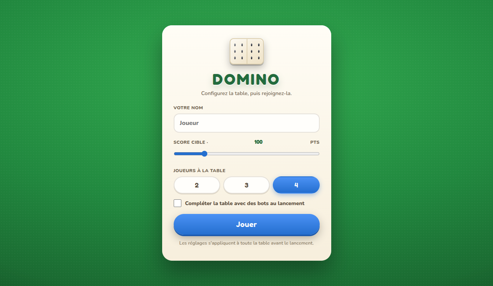
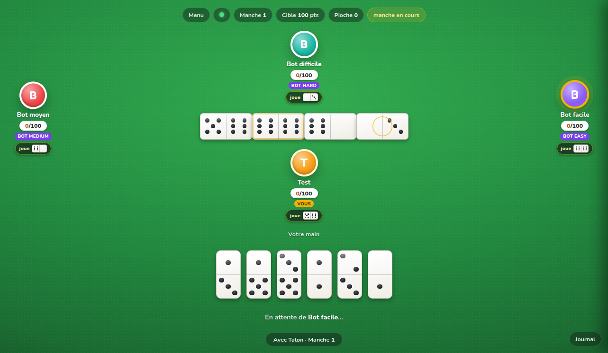
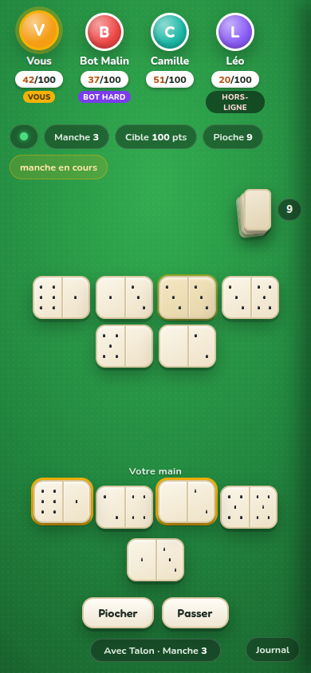

# 🁫 Domino (Rust)

Jeu de domino **multijoueur en réseau local (LAN)**, écrit en Rust. Un hôte lance
le serveur, ses amis ouvrent l'adresse affichée dans leur navigateur — même Wi-Fi,
**aucun install**, 2 à 4 joueurs autour de la même table. La logique est intégralement
côté serveur (**serveur autoritaire**, rien n'est trichable) ; le client web embarqué
dans le binaire rend la table directement dans le navigateur.

## Jouer à plusieurs (réseau local)

1. L'hôte lance le jeu : `./serveur.sh` — l'adresse LAN s'affiche au démarrage :
   ```
   🁫  Domino — serveur prêt
       Vous  : http://localhost:8080
       LAN   : http://192.168.0.40:8080
       Cible : 100 pts — vos amis ouvrent ce lien dans leur navigateur.
   ```
2. Chaque ami (téléphone, tablette ou ordinateur **sur le même réseau**) ouvre
   l'adresse `http://192.168.x.x:8080` dans son navigateur.
3. Tout le monde passe par le menu principal (nom, score cible, taille de table),
   puis un joueur lance la partie — les sièges vides peuvent être complétés de bots.

Chaque client voit la même table en temps réel ; si un joueur ferme sa page en
cours de manche, un bot reprend sa main pour ne jamais bloquer la partie.

| Menu principal | Table en jeu (desktop) | Mobile |
|---|---|---|
|  |  |  |

## Règles implémentées

- 28 dominos (0-0 à 6-6), **2 à 4 joueurs**, 7 jetons chacun, le reste en **pioche**.
- **La main** : à la première manche, celui qui détient le plus gros double
  (à défaut le plus gros domino) joue en premier et ne peut poser que ce domino.
  Aux manches suivantes, le suivant de l'ouvreur ouvre et peut poser n'importe
  quel domino.
- On joue dans le sens antihoraire ; un domino se pose sur l'extrémité
  correspondante. Un joueur sans coup légal **pioche** ; s'il n'en a toujours
  pas et que la pioche est vide, il **passe**.
- **Manche ouverte** : qui pose le dernier domino marque la somme des points
  des adversaires.
- **Manche bloquée** : chacun compte les points de sa main, le plus petit total
  gagne et marque le reste ; en cas d'égalité, « la main » départage.
- **Fin de partie** : premier joueur à atteindre l'objectif (configurable
  50–300, défaut 100).

Les règles sont prouvées par la suite de tests de `domino-core`
(27 tests, dont des parties complètes simulées à 2, 3 et 4 joueurs et des
invariants : conservation des 28 jetons, scores non négatifs, etc.).

## Démarrage rapide

```bash
cargo build --release -p domino-server   # une seule fois (ou après modification)
./serveur.sh                             # lance le serveur sur http://localhost:8080
```

`serveur.sh` gère tout : `start [port]`, `stop`, `restart`, `status`. Il
**recompile automatiquement** si le code ou la page web a changé depuis le
dernier build (plus jamais d'ancienne version servie par accident).

Le flux complet (hôte + amis sur le même réseau) est décrit dans
[Jouer à plusieurs](#jouer-à-plusieurs-réseau-local).

### Options manuelles (sans script)

```bash
# Jeu local : vous contre 3 bots (objectif 100 pts)
./target/release/domino --port 8080 --target 100 --bot-fill

# Table de 2 joueurs, objectif 200, bots pour les places vides
./target/release/domino --port 8080 --players 2 --target 200 --bot-fill
```

Options : `--port` (défaut 8080), `--target` (50–300, défaut 100),
`--players` (2–4, défaut 4), `--bot-fill` (remplit les places vides de bots
au lancement), `--seed` (graine aléatoire, parties reproductibles).

## Structure du projet

```
Domino rust/
├── Cargo.toml              # workspace
├── serveur.sh              # start / stop / restart / status (+ recompilation auto)
├── crates/
│   ├── domino-core/        # logique pure, sans I/O (Tile, Board, Game, bots)
│   └── domino-server/      # serveur HTTP + WebSocket (tokio) + client web embarqué
│       ├── build.rs        # embarque les avatars PNG au compile
│       ├── names.txt       # 400 prénoms français INSEE 1900-2022 (noms des bots)
│       └── web/
│           ├── index.html  # interface complète (HTML/CSS/JS, fichier unique)
│           └── avatars/    # avatar0..19.png (cartoon, générés par Gemini — voir tools/)
├── test/smoke.mjs          # test de fumée : joue une partie complète via le protocole
├── tools/gen_avatars.py    # génération des 20 avatars (Gemini) + README
└── docs/screenshots/       # captures du client (menu, table, animations, mobile)
```

- `domino-core` : aucune dépendance réseau, testable en isolation.
- `domino-server` : serveur autoritaire ; les clients envoient des
  **intentions** et reçoivent l'état complet (uniquement quand il change).
- Les **bots** sont simulés côté serveur (3 niveaux : facile / moyen /
  difficile) avec un **prénom français aléatoire** tiré de `names.txt` ;
  un joueur qui se déconnectne pendant la manche est relayé par un bot.

## Le client web

Fichier unique (`web/index.html`, CSS/JS inline), embarqué dans le binaire au
compile — un seul fichier à copier sur la machine hôte.

- **Menu principal** : nom du joueur, slider score cible (50–300), sélecteur
  de table (2/3/4 joueurs), option « compléter avec des bots ». Rouvrable via
  le bouton « Menu » du HUD tant que la manche n'a pas commencé.
- **Table immersive** : felt vert plein écran, joueurs disposés autour du
  plateau (vous en bas), avatars à anneau coloré + pilule de score, tour actif
  en halo or pulsant.
- **Dominos « blanc net »** : faces blanches avec reflets, pips noirs ronds
  brillants, doubles à liseré or ; main verticale (1:2) et plateau horizontal
  (2:1), chaîne continue sur le felt.
- **Zones de pose** : indicateurs en pointillés or pulsants aux extrémités
  jouables de la chaîne (dérivées des `legal_moves` du serveur).
- **Animation de pose** : le domino décolle de la main (ou de l'avatar du bot),
  bascule en vol, retombe sur sa place exacte avec rebond et onde d'impact dorée.
- **Badges d'action** : sous chaque avatar, la dernière action (« joue » +
  mini-domino posé, ou « passe ») persiste jusqu'au tour suivant de ce joueur.
- **Avatars cartoon** : un visage par joueur (hash du nom → `avatarN.png`),
  repli automatique sur l'initiale colorée si le PNG est absent.
- Responsive mobile, `prefers-reduced-motion` respecté.

## Tests

```bash
cargo test                 # toute la logique + parties simulées
# puis, dans un autre terminal :
./target/debug/domino --port 8091 --target 50
node test/smoke.mjs        # joue une partie complète contre 3 bots via WebSocket
```

## Protocole (WebSocket JSON)

Le client envoie des intentions, le serveur renvoie l'état complet
(`your_id`, `players`, `board`, `boneyard_len`, `turn`, `phase`,
`legal_moves` pour vous, `log`, scores, objectif, résultat de manche, etc.) —
**uniquement quand il change**.

| Intention    | Corps                                              | Quand            |
|--------------|----------------------------------------------------|------------------|
| `join`       | `{name}` (vide → « Joueur »)                       | waiting          |
| `rename`     | `{name}`                                           | waiting          |
| `config`     | `{target?, max_players?, fill_bots?}`              | waiting          |
| `play`       | `{tile: "3-5", side: "left"\|"right"}`             | playing, mon tour|
| `draw`       | `{}`                                               | playing, mon tour|
| `pass`       | `{}`                                               | playing, mon tour|
| `start`      | `{}` (complète avec bots si `fill_bots`)           | waiting          |
| `next`       | `{}`                                               | round_over       |
| `add_bot`    | `{level: "easy"\|"medium"\|"hard"}`                | waiting          |
| `remove_bot` | `{id: n}`                                          | waiting          |

## Génération des avatars (Gemini)

Les 20 visages cartoon (`web/avatars/avatar0..19.png`) sont générés par le
script `tools/gen_avatars.py` via l'API Gemini — voir `tools/README.md`.
Ils sont embarqués au compile : après génération, relancer
`./serveur.sh restart` suffit.

## Notes de conception

- **Serveur autoritaire** : l'état est reconstruit côté serveur ; les
  messages clients sont des intentions, jamais de l'état.
- **Un seul verrou** (`tokio::sync::Mutex<Game>`) sur la partie ; les
  opérations sont atomiques et l'ordre des tours est séquentiel.
- **Broadcast économe** : le serveur met en cache le dernier état envoyé par
  siège et ne renvoie que les changements réels (aucun message parasite,
  animations stables côté client).
- **Le bot qui remplace un humain déconnectné** reprend sa main, pour ne
  jamais bloquer la table.
- Le client web est **embarqué dans le binaire** (`include_str!`), donc un seul
  fichier à copier sur la machine hôte.
